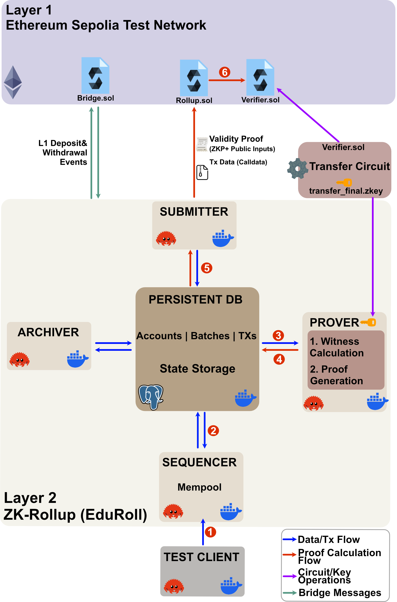

# EduRoll
EduRoll: End-to-End Ethereum zk-Rollup (L1 Contracts, L2 Components and Circuits) Built From Scratch

> **Research / educational prototype — NOT production-ready, NOT audited.**
> EduRoll demonstrates the end-to-end ZK-rollup proving pipeline. In its current version it omits security and infrastructure required for a real deployment: trustless L1 and L2 bridging, a multi-party trusted setup in Phase 2, decentralised sequencing, forced-inclusion/exit, rate-limiting, fees, and more.

## What it is

**EduRoll** is an end-to-end zk-rollup prototype built entirely from scratch:
- L1 smart contracts (`Rollup.sol`, `BridgeERC20.sol`, `Verifier.sol`)
- L2 sequencer, prover, submitter, and archiver (Rust + Docker)
- ZK transfer circuit (Groth16, Circom)
- PostgreSQL data layer and a test client (Dockerised)

It demonstrates the full lifecycle of a zk-rollup on Ethereum: **state execution -> batching -> proving -> L1 verification -> state finalisation** with each batch's transactions posted to L1 as **calldata** for data availability.

**Design decisions, component internals, the trusted-setup details, and the full list of limitations are in [`docs/README.md`](./docs/README.md).**

### EduRoll's Scope
**Implemented & working:** 
  1. EdDSA-signed L2 transfers
  2. Batching
  3. A witness built from the PostgreSQL batch data
  4. Groth16 validity proof
  5. On-chain verification
  6. State-root finalisation with calldata DA
  7. Single ERC-20 asset
  8. Fixed 20 tx/batch
  9. Authorised-submitter access control

**Illustrative and not yet wired end-to-end:**
1. The L1 and L2 **bridge** (deposits queue on L1 but are not credited on L2 and withdrawals are not claimable yet)
2. Live deposit ingestion
---

## System Architecture (high-level)

<a href="./docs/assets/diagrams/SystemOverview.png">
  
</a>

- **L1 (Ethereum):**
  - `Rollup.sol:` Verifies the batch proof and DA commitment, holds the state root
  - `Verifier.sol:` snarkjs Groth16 verifier
  - `BridgeERC20.sol:` L1 custody
- **L2 (off-chain, Rust):**
  - **sequencer:** Validates, orders and executes txs from test_client into batches 
  - **prover:** Generates one Groth16 proof per batch
  - **submitter:** Posts proven batches and calldata DA to L1
  - **archiver:** Indexes for auditing purposes
- **PostgreSQL PersistentDB:** Acts as the async coordination hub between dockerised L2 components
- **test_client:** Generates EdDSA-signed transactions

See [`docs/README.md`](./docs/README.md) for the detailed component breakdown and operational flow.

---

## Test Environment & Running

**Development machine:** MacBook Pro, M1 Pro (10 Cores), 16 GB RAM.

[Colima](https://github.com/abiosoft/colima),a lightweight Docker alternative for low-resource systems, is used and pre-wired in the scripts. To use plain Docker, edit the scripts first.

```bash
# 1. Build the ZK artifacts (Compile circuit -> trusted setup -> export Verifier.sol)
bash ./simulation-scripts/build-circuit.sh

# 2. Fresh simulation start (Compile the project and docker containers, seed accounts, deploy L1 contracts, start all docker services)
bash ./simulation-scripts/run-fresh.sh

# 3. Pause the simulation
bash ./simulation-scripts/run-pause.sh

# 4. Resume (Keeps the DB + L1 state)
bash ./simulation-scripts/run-resume.sh

# 5. Remove (All docker containers, Rust and Forge compiles)
bash ./simulation-scripts/remove.sh
```

Inspect a service's logs:
```bash
docker-compose logs -f # all services
docker-compose logs -f CONTAINER_NAME # i.e: sequencer / prover / submitter / archiver / test_client / anvil 
```

### SP1 backend tests

The SP1 proving backend (`circuits/sp1/`) is a separate, nested Rust workspace. Its tests and guest execution run locally on the same 16 GB machine. However, the actual proof generation needs ~37 GB RAM, therefore a cloud/GPU server. See [`docs/README-SP1.md`](./docs/README-SP1.md).

```bash
# Parity tests (Poseidon / Merkle / EdDSA byte-identical to the Circom pipeline)
( cd circuits/sp1 && cargo test -p zk-precompiles -p stf-core --release )

# Execute the guest (It prints the roots and total cycle count)
( cd circuits/sp1/script && RUST_LOG=info cargo run --release -- --execute )

# Guest verification key (RollupSP1 constructor arg)
( cd circuits/sp1/script && cargo run --release --bin vkey )

# Contract tests (RollupSP1.sol against mock verifiers)
( cd circuits/sp1/contracts && forge test )

# Core proof (It needs ~37 GB of RAM. Run on a cloud/GPU server, unless your machine has that much RAM.)
( cd circuits/sp1/script && RUST_LOG=info cargo run --release -- --prove )
```

---

## Results - Groth16
Local runs of the 20-tx circuit (20 transfers + 4 deposit slots).

| Metric | EduRoll | Notes |
|---|---|---|
|Total Circuit constraints | ~1.17M | 20-tx circuit (transfers + deposits), Linear: ~544K, Non-linear: ~628K|
| Witness generation | ~1.8 s | |
| Proof generation | ~80 s | snarkjs Groth16 |
| Trusted setup (Phase 2) | ~3 min | One-off `groth16 setup` and contribution |
| Proof Size | ~256 bytes | Groth16(A,B,C), constant |
| DA Calldata per Batch | ~3.12 KB | 20 txs posted to L1 |
| Gas cost submitBatch() including DA | ~327,418 | Predates `circuitVersion`/`l1BlockNumber` enforcement (below) |
| Amortised L1 gas per Tx | ~16,371 | |

> `submitBatch()` now also enforces `circuitVersion` and bounds `l1BlockNumber`
> (previously carried but unchecked — see `src/Rollup.sol`). Measured delta on
> the same Foundry unit test (`test/Rollup.t.sol::test_SubmitBatchPath`, mock
> verifier): **83,129 → 83,252 gas (+123)**. The 327,418 figure above is from
> a real end-to-end simulation run (real Groth16 proof + real ~3.2 KB DA) that
> predates this change and hasn't been re-run — the mock-verifier delta is a
> reasonable proxy for the real-verifier delta, but isn't the same measurement.

### L1 deployment gas (one-time, measured on Anvil)
| Contract | Gas |
|---|---|
| MockToken (test ERC-20) | 563,807 |
| Groth16Verifier | 366,287 |
| BridgeERC20 | 341,027 |
| Rollup | 887,336 |

> Rollup's deployment cost includes the `circuitVersion`/`l1BlockNumber`
> enforcement above (was 859,975); the other three contracts are untouched
> and this re-run reproduces their figures exactly, via `forge script
> script/Deploy.s.sol:Deploy --broadcast` against a fresh local Anvil.
---

### Proving Backend comparison: Groth16 (Circom) vs SP1 (zkVM)

| Metric | Groth16 (Circom) | SP1 (zkVM) |
|---|---|---|
| Proving statement | ~1.17M R1CS constraints | ~132M-165M RISC-V cycles (20 tx; flat in *touched* accounts, not *registered* accounts — see note) |
| Trusted setup | Per-circuit | None (universal setup) |
| Proof generation | ~80 s | Needs ~37 GB RAM (documented estimate, not measured — no `--prove` run performed) |
| On-chain proof size | ~256 Byte | Groth16/PLONK-wrapped (~260 Byte) |
| On-chain verify | ~327,418 gas | realistic DA + state update ~239k (measured, mock verifier — `circuits/sp1/contracts/test/RollupSP1.t.sol::test_GasWithRealisticDataAvailability`) + SP1 gateway ~270-300k (documented, not measured) ≈ ~510k-540k |

> **SP1 cycle count:** measured via `SP1_PROVER=mock cargo run --release --
> --execute` (execute-only, no proof). 131.9M-137.2M cycles over a 32-account
> tree, 162.9M-164.7M over 1,000 accounts (3 runs each). The guest's cost is
> flat in the number of *distinct touched accounts* (it takes a sparse
> witness, not the full tree) — the gap above is sampling noise: `demo_batch`
> draws 20 random (sender, recipient) pairs, and a 32-account pool sees more
> collisions (fewer distinct accounts touched) than a 1,000-account pool.
> "Flat in user count" is directionally true but imprecise as worded; treat
> the range above as the honest number rather than a single ~160M figure.


## Possible Improvements
1. **Decentralised sequencer network:** A PoS or PoA sequencer set removes the single point of failure for liveness and censorship.
2. **Alternative data availability for Circom prover:** EIP-4844 blobs or modular DA (Celestia / EigenDA) to reduce DA cost.
4. **Trustless bridge:** Proof-bound deposits and withdrawals.
5. **Larger batch size:** C++ witness generation and an optimized prover (e.g., Rapidsnark) to manage increased constraint sizes and memory footprint.